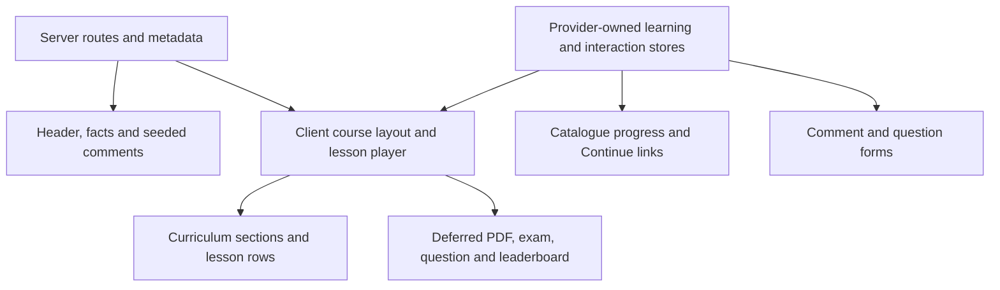

# ITLegend course player

An isolated Next.js App Router and TypeScript frontend with six anonymous course journeys. The player implements inline video, sticky mobile playback, desktop Wide/fullscreen, curriculum selection, course progress, PDF/exam/question/leaderboard dialogs and local comments. It follows the supplied desktop/mobile image and Arabic annotations. Exact photo/avatars, confirmed source-font metadata and physical-phone checks remain open; this is not a claim of complete fidelity or competition clearance.

## Run locally

Use Node **22.13+ within 22.x, or 24+**. Verification uses Node 22.14.0/npm 10.9.2; `package-lock.json` pins the installed dependency graph. No account, API keys, backend or environment variables are required.

```sh
npm ci
npm run dev
```

Production preview:

```sh
npm run build
npm run start -- --port 3100
```

Scripts bind to localhost. Open `http://127.0.0.1:3100`; this is a local preview, not a deployment. GitHub visibility is independent of package.json's `private: true`, which prevents accidental npm publication.

## Architecture

| Location                            | Responsibility                                                                                     |
| ----------------------------------- | -------------------------------------------------------------------------------------------------- |
| `src/app`                           | Server route pages, metadata, root layout and not-found handling; awaited route/search parameters  |
| `src/app/fonts.ts`, `src/app/fonts` | Self-hosted Latin font definitions and accompanying OFL notices                                    |
| `src/data`, `src/types`             | Six course fixtures, explicit discriminated lesson types, worksheet, quiz and motivational content |
| `src/lib`                           | Shared lesson/status/progress/ranking selectors and media-query subscription                       |
| `src/features/catalogue`            | Course cards with course-specific progress and remembered Continue destinations                    |
| `src/features/course`               | Player/layout/curriculum, server facts/comment slots, focused dialog/form components               |
| `src/features/learning`             | Separate provider-owned learning and interaction stores with validated pure transitions            |
| `src/components`                    | Shared native dialog shell and original inline SVG icons                                           |
| `public`                            | Original local SVG illustrations, WebM/captions and worksheet PDF/page preview                     |
| `tests`, `scripts`                  | Unit/browser checks, lint guard, authoring tools and reproducible production measurements          |

Server pages resolve valid URLs and supply static header, facts and seeded comment rows as server slots. Client components handle media, layout controls, curriculum, forms and state subscriptions. Fixture modules stay out of the client JavaScript graph; the route serializes only relevant display content and the providers receive minimal validation seeds. New comment rows are a client island. Dialog code is dynamically imported only after a dialog opens. There is no arbitrary-PDF renderer, external UI library, third-party font request at runtime or analytics bundle. Fonts are local WOFF2 files loaded through `next/font/local` at the root layout; the application builds without a Google Fonts network dependency.

Curriculum responsibilities are explicit: `Curriculum` coordinates accordion and course state, `CurriculumSection` renders a labelled group, and `CurriculumLesson` renders one navigable lesson. `ProgressMarker` is shared by the desktop progress summary and the mobile first-section marker; its mobile lane reserves space for endpoint values and longer titles. Native dialog semantics and the shared `TextEntryForm` serve every popup/form without a duplicate state store.



Learning state tracks selected/completed lessons and per-lesson playback positions. A separate interaction store tracks question/comment drafts, posted demo rows and quiz attempts so typing does not update the media/progress subscription. Stores belong to the mounted providers: no mutable server singleton, cross-user state, backend, localStorage or sessionStorage. Pure transitions reject foreign IDs, invalid options/indices, nonfinite positions, blank/oversized messages and duplicate completion/submission. Course-specific snapshots keep unrelated courses unchanged.

URLs select lessons, support direct links and browser back/forward, and fall back safely for invalid lesson IDs. Missing courses show a 404. Local state survives dialog reopening and client navigation; **hard reload/new tab resets fixtures**. This lifetime is an engineering default; cross-reload persistence is optional and the source does not specify it.

## Design and required behavior

CSS Modules share color variables. Desktop places the player beside curriculum with the source's column/gap relationships. Below 1024px content stacks; below 768px the player stays sticky, with measured section-scroll offsets and a short-viewport height cap. Controls retain 44px targets. One dataset serves every width. The reference course shows the shorter desktop title and full mobile title; the accessible heading and metadata retain its full name. Optional data aliases provide presentation labels without duplicating courses or lesson state. Canonical facts/syllabus keep the screenshot's conflicting datasets explicit; see [design review](verification/Design-Review.md).

Play starts the original silent demo **inline**, with native controls, captions and an accessible transcript. No autoplay on lesson selection; `preload="none"` prevents initial video downloads. Normal/Wide/fullscreen keep one mounted video and its time. Changing lesson retains its own position. Maximize requests real browser fullscreen or the native video fallback, with truthful unavailable/error feedback. Actual phone fullscreen with auto-rotate disabled remains unverified.

Ended video credits completion once. PDF completion requires explicit **Mark read**. A fully answered submitted exam credits completion once regardless of score; the result becomes immutable while answers remain reviewable. Initial SEO completion is five video lessons out of eight, rounded to 63%; PDF/exam start unfinished. Progress and Continue destinations stay consistent with the catalogue. Progress animates on viewport entry; reduced motion shows its final value directly.

The shared native dialog supplies modal semantics, inert background, contained Tab/Shift+Tab, Escape, visible Close, focus return and body-scroll restoration. PDF/exam cover the viewport. PDF displays the actual rendered original page with fit/150%/200% zoom, equivalent accessible text and an original-file link; preview failure exposes text automatically. Questions share comment styling and retain drafts. Comments validate input and render submitted content as literal text. Demo submissions have no network side effects.

The exam follows the blue surface, numbered navigation and white answer card. Its five questions are original fixtures and **untimed**: the illustrated timer supplies no countdown/failure policy. The compact leaderboard uses fictional learners, tied ranks and level-dependent original Arabic encouragement with RTL and ordinary emoji. Copy is not an authentic Ali Shahin quote or endorsement. Completion, level and quiz rules are documented engineering defaults, not official organizer policies.

M4 adjusts sampled colors for contrast: action teal `#217b6a` is 5.11:1 on white; progress green `#438f63` is 3.23:1 on its track. Main/section targets accept keyboard focus and inputs have visible boundaries. Typography now uses locally hosted Poppins body text and Spartan headings, selected by visual comparison; exact source-family metadata is still unconfirmed. Original photo/avatars remain illustrative substitutes. Populated demo rows, an untimed quiz label and functional Close controls remain declared differences. The exam uses native radio semantics styled as the reference's square controls, with a native appearance fallback in forced colors and a white back-chevron Close on the blue surface. The screenshot-only Figma export is intentional and remains the reference; inaccessible live Figma was not repeatedly retried. [Asset provenance](ASSETS.md) records every included source and limitation.

## Usage and extending the fixtures

Open the catalogue and choose Start or Continue. Select a curriculum lesson to update the player and its URL. Play remains inline; use Wide on desktop or Maximize for browser fullscreen. Curriculum/comments controls scroll to their sections, and the other two controls open question and leaderboard dialogs. PDF and exam rows open screen-sized dialogs; answers, question drafts and posted comments remain in the current client session.

To add a course, create a typed entry in `src/data/courses.ts` with a unique slug, section/lesson IDs and valid `initialLessonId`/`initialCompletedLessonIds`. Catalogue cards, routes and provider seeds derive from that data. Lesson kinds are discriminated in `src/types/course.ts`: videos require media/captions/transcript, PDFs require a worksheet, and exams require a structured question set. Keep original content separate from presentation aliases, and update tests when changing fixture contracts.

Use `src/data/learning-resources.ts`, `worksheet.json` and `motivation.ts` for resources, quiz content and level-dependent Arabic messages. Existing authoring scripts regenerate original demo media/worksheet assets with authoring-only tools; they are not required to run the app. Record replacement assets and their permissions in `ASSETS.md`. Keep stylesheet changes in CSS Modules and shared tokens in `src/app/globals.css`, and verify long text and intermediate widths after changes.

## Verification

```sh
npm run check
npm run format:check
npm run test:unit
npm run build
npm run test:e2e
```

`check` combines TypeScript, ESLint and invalid-snippet guards proving Next, Hooks and accessibility rules remain active. ESLint 10 uses the official `@eslint/compat` bridge for preset plugins still calling removed context APIs; no rules are disabled. Unit checks use Node's experimental type stripping, with runner-only warnings.

Playwright uses installed Chrome, starts/reuses the production server on port 3100, and runs one worker with no retries. `CI=true` forces a fresh server. For Edge set `PLAYWRIGHT_CHANNEL=msedge`; for Playwright Chromium install its browser and set `PLAYWRIGHT_CHANNEL=chromium`. No browser download was needed in this environment. In PowerShell, use `$env:PLAYWRIGHT_CHANNEL = "msedge"`.

The suite also verifies mobile marker bounds at 0%, 63% and 100%, fonts without third-party runtime requests, and waits for font readiness before captures. It covers six journeys, URL/history/404 handling, playback/resume/ended/Wide/fullscreen, isolated state, all popup/comment flows, native keyboard focus, layout bounds, long Arabic/unbroken content, varied lesson counts, 200% root text sizing plus increased text spacing, rendered Axe checks and computed text/control/focus contrast. M5 adds mobile/desktop request-level checks that video/PDF payloads wait for intent. No timing threshold is used as a flaky functional assertion.

Default screenshot reruns use ignored `verification/local-current-*` names. Set `VERIFICATION_MILESTONE=m5` only when intentionally saving a new milestone; use `$env:VERIFICATION_MILESTONE = "m5"` in PowerShell. Existing M1-M4 captures must not be overwritten. [M4 evidence](verification/M4.md) records the previous 26-flow verification; [M5 production evidence](verification/M5.md) records historical performance conditions; [design review](verification/Design-Review.md) records the previous comparison; [screenshot implementation evidence](verification/Screenshot-Implementation.md) records the latest refinements and fresh checks.

Axe results and emulated viewports are bounded evidence, not WCAG certification. Actual screen-reader review, browser-native zoom, physical-phone fullscreen/orientation, Safari, touch and virtual-keyboard behavior remain open. Root text sizing and 320 CSS pixel reflow do not establish native browser zoom behavior.

## Performance measurement

With the production server already running, use another terminal:

```sh
node scripts/measure-production.mjs
node node_modules/next/dist/bin/next experimental-analyze --output
node scripts/summarize-bundle.mjs
```

Reports default to ignored `verification/local-*.json`. An optional output-path argument saves intentional milestone evidence. `PERF_BASE_URL` overrides the measurement target; the default is localhost. The analyzer is built into the installed Next version and performs a separate experimental compile, not a deployable build. Its summarizer supports the inspected Next 16.3.8 internal format and fails visibly if that format changes. Runtime bytes are measured separately.

The lab script records three fresh, cache-disabled loads per route/profile: 1440x1000 desktop/DPR1/local CPU/network, and 430x932 touch viewport/DPR2 with 4x CPU slowdown, 150ms latency, 1.6Mbps download and 0.75Mbps upload. It observes load plus four seconds without input on a warm localhost server. It records navigation/paint/LCP, session-window CLS, long tasks, requests, image dimensions and asset/chunk inventories. This is neither Lighthouse nor field Core Web Vitals/INP. Hardware, local server, observation window and synthetic throttling limit interpretation.

Small original SVGs preserve intrinsic dimensions without raster conversion. Four self-hosted Latin WOFF2 files total 56,640 source bytes: three Poppins weights and one Spartan variable font. The heading font is preloaded; body weights are discovered as used. Non-Latin comments and Arabic use the system fallback. Licenses and downloaded hashes are recorded in [asset provenance](ASSETS.md). The worksheet PNG is optimized by `next/image` into a responsive WebP; original PDF/video bytes wait for explicit actions. Native preload-none media, conditional dialogs, server slots and minimal seeds avoid unnecessary initial payloads.

Fresh measurements at code revision `376c74d` include the font changes: mobile lab median LCP is 1,324ms catalogue /1,416ms player, with observed CLS zero across those six mobile samples. Desktop medians are 420ms /380ms; maximum desktop CLS is 0.001808. Initial completed font responses total 49,790 bytes including overhead (three files actually requested); completed Script responses total 149,282 catalogue /165,349 player bytes. These bounded lab values describe the current build, not a field-performance guarantee or a controlled speed comparison with M5. [Latest evidence](verification/Screenshot-Implementation.md) records conditions and raw results; M5 retains historical module analysis and measurements.

## Release and submission limits

On 2026-10-04 the full npm audit still reports five high-severity entries in one **development-only** chain: braces → micromatch → fast-glob → Next lint plugin/config. The production-only audit reports zero. [The official advisory](https://github.com/advisories/GHSA-vfj7-8cjw-p6xm) lists no patched version; registry latest braces remains 3.0.3. npm's suggested config downgrade to 14.2.35 is not a compatible release fix for this Next 16 project. No forced downgrade, vendored patch, rule disabling or unnecessary dependency installation was applied. Legacy lint plugin peer-range limitations remain recorded. Recheck upstream before publication.

Local Git uses the user's configured author/committer and meaningful staged-work commits. No remote is configured because the destination/name/visibility is still missing; no private code/history was imported, and no push/deployment/submission occurred. Source DOCX/PNG and the existing app/deployment are outside this isolated implementation.

Official sources read on 2026-10-03 require an individual, one submission, a public GitHub repository and an anonymous live demo; displayed deadline is **31 October 2026, 9:59 p.m., timezone unresolved**. AI assistance, reuse, external assets, additional-feature policies and eligibility nuance remain unanswered. Silence is not permission. These rules require a fresh readiness check before authorized publication/submission. Rubric evidence is not an official judging score.

The parent Obsidian vault retains requirements, source locators, decisions and handoff. Technical references checked 2026-10-04: [Next bundle analysis](https://nextjs.org/docs/app/guides/package-bundling), [Next Image](https://nextjs.org/docs/app/api-reference/components/image), [Chrome network conditions](https://developer.chrome.com/docs/devtools/network/reference), [LCP](https://web.dev/articles/lcp), [CLS](https://web.dev/articles/cls).
